<p align="center">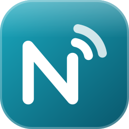</p>

<p align="center"><a href="https://github.com/FirmanKurniawan/NextMon">NextMON</a> (aplikasi) &nbsp;·&nbsp; <b>NextMON Server</b> (peluncur Windows .exe) &nbsp;·&nbsp; <a href="https://github.com/FirmanKurniawan/NextMon/releases">Releases</a></p>

# NextMON Server

Peluncur Windows untuk [**NextMON**](https://github.com/FirmanKurniawan/NextMon) (pengelola hotspot MikroTik, pesaing Mikhmon; kode aplikasi dan dokumentasi fitur ada di repo itu): satu file `NextMON Server.exe` portabel, tanpa instalasi dan tanpa hak administrator. Pesaing *Mikhmon Server* dengan fitur lebih lengkap: panel kontrol, manajer runtime PHP/Node, dan dua edisi aplikasi.

- Menjalankan **satu edisi dalam satu waktu**: **PHP** *atau* **Next.js**. Mengganti edisi menghentikan yang lama lebih dulu. Data kedua edisi terpisah (`data/php`, `data/next`).
- **Manajer runtime**: pasang, ganti, dan upgrade versi **PHP** (windows.php.net) dan **Node.js** (nodejs.org) dari panel. Unduhan diverifikasi SHA-256, upgrade punya health-check dan rollback.
- Ikon **tray**, **panel kontrol** web (jendela WebView2, atau browser bila WebView2 tidak ada), dan **CLI**.
- Restart otomatis bila aplikasi crash (dengan backoff), **backup/restore** data, cek pembaruan dari GitHub Releases, diagnostik, autostart Windows (opsional).
- Panel dan API kontrol hanya di `127.0.0.1` secara bawaan, dengan token acak.

> Status: **v0.1.0**. Teruji di Windows 11 (lihat "Yang sudah teruji" di bawah). Belum ditandatangani digital, jadi Windows SmartScreen bisa memperingatkan.

## Tampilan

Tangkapan layar panel kontrol asli (dari rilis v0.1.0, mode demo mati).

<table>
<tr><td align="center">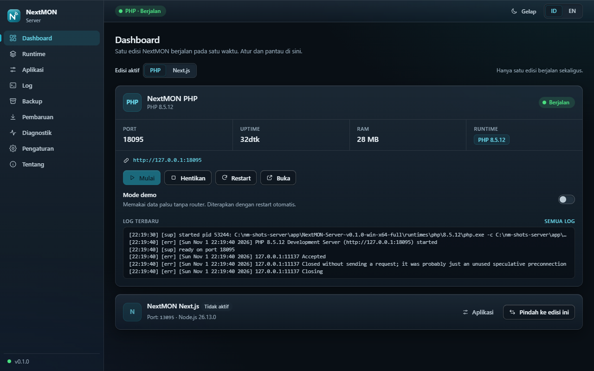<br><sub>Dashboard (gelap): status, uptime, RAM, dan log terbaru</sub></td><td align="center">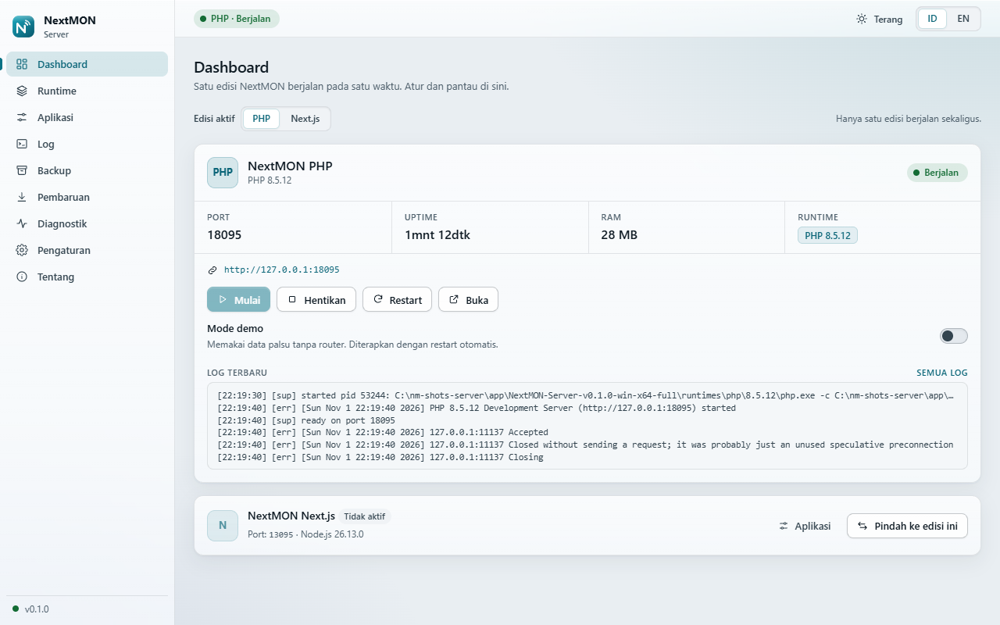<br><sub>Dashboard (terang)</sub></td></tr>
<tr><td align="center">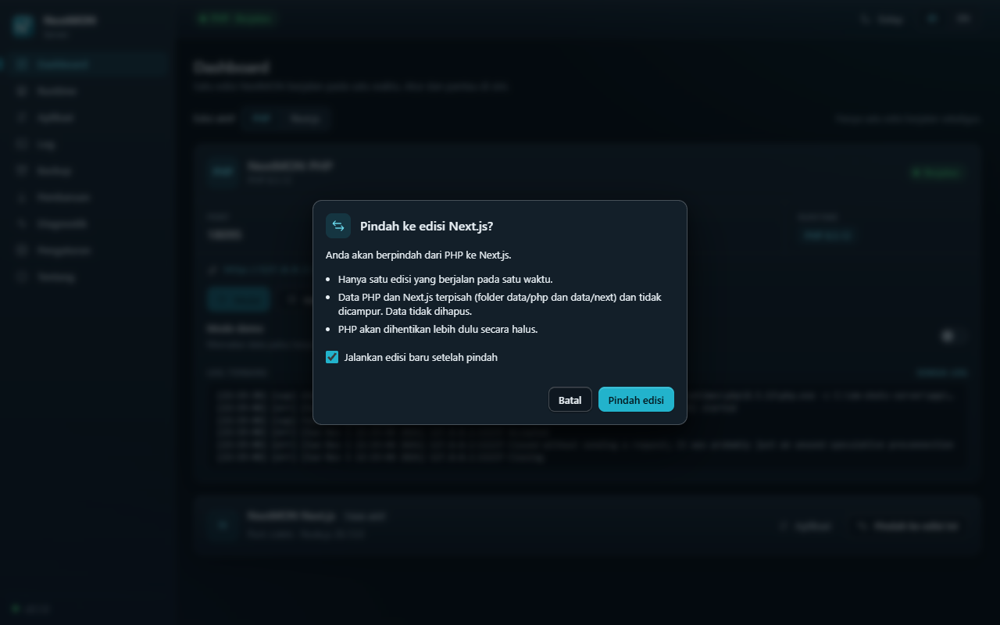<br><sub>Konfirmasi pindah edisi PHP ke Next.js</sub></td><td align="center">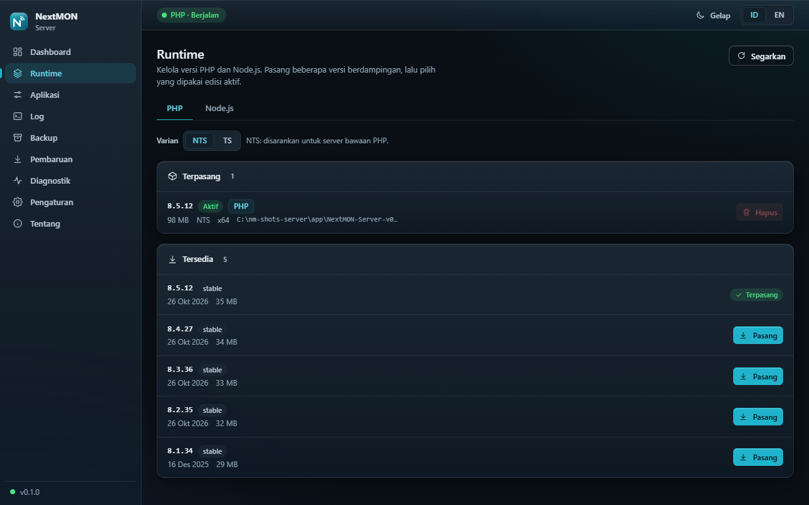<br><sub>Manajer runtime: versi terpasang dan tersedia</sub></td></tr>
<tr><td align="center">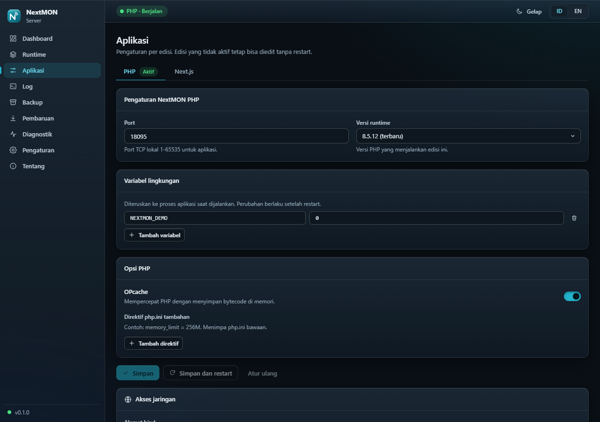<br><sub>Aplikasi: port, versi runtime, variabel lingkungan</sub></td><td align="center">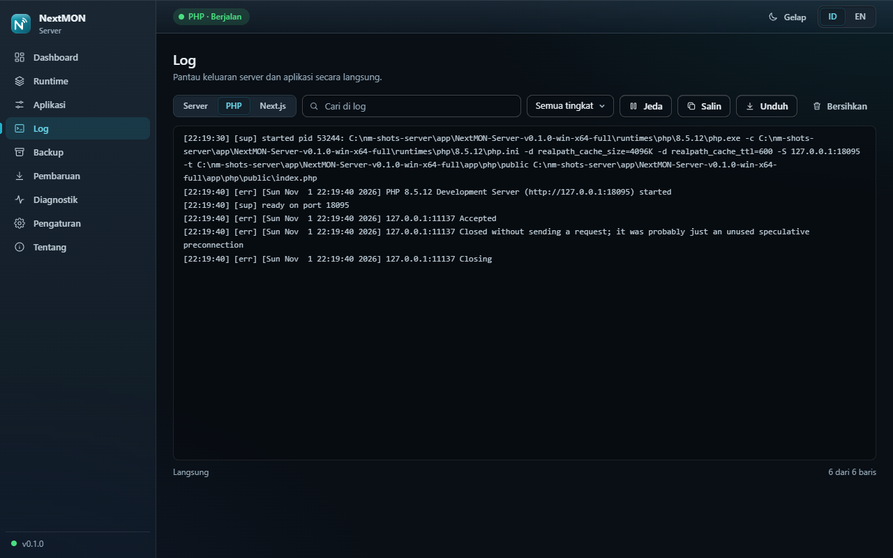<br><sub>Log langsung dengan filter dan pencarian</sub></td></tr>
<tr><td align="center">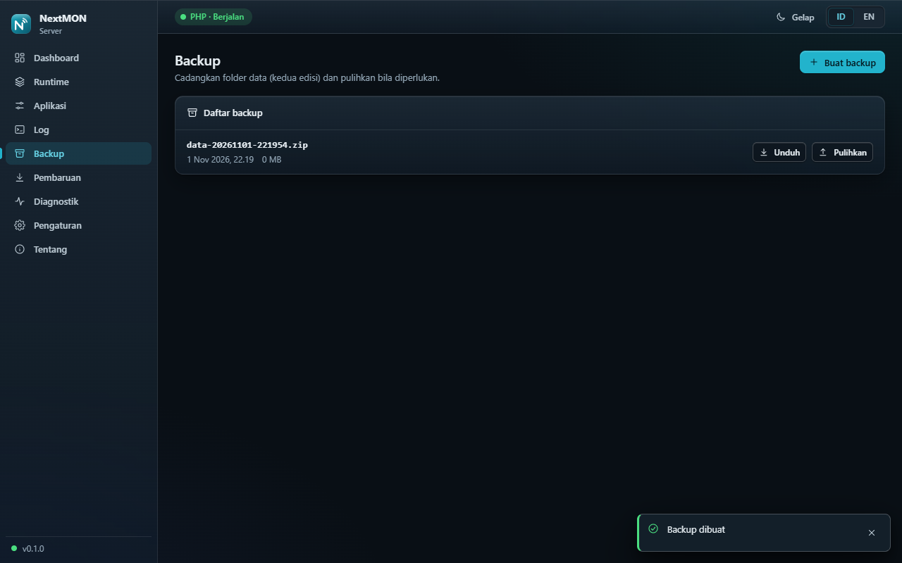<br><sub>Backup dan pulihkan data</sub></td><td align="center">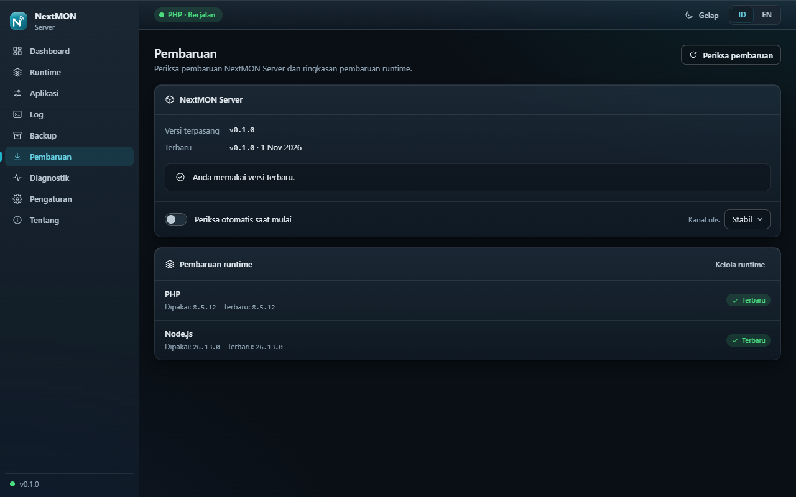<br><sub>Pembaruan aplikasi dan runtime</sub></td></tr>
<tr><td align="center">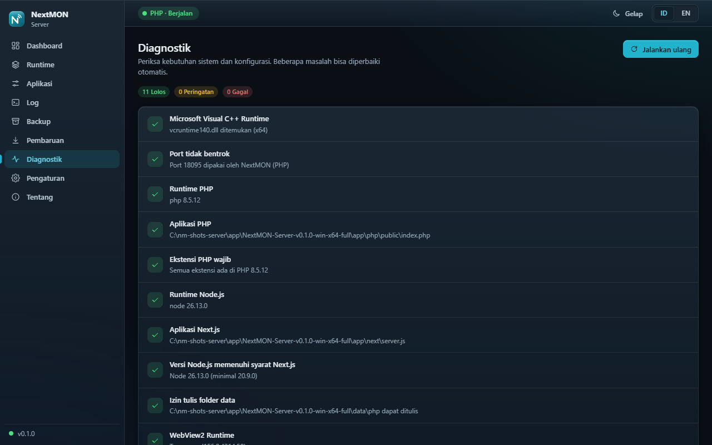<br><sub>Diagnostik sistem dengan perbaikan otomatis</sub></td><td align="center">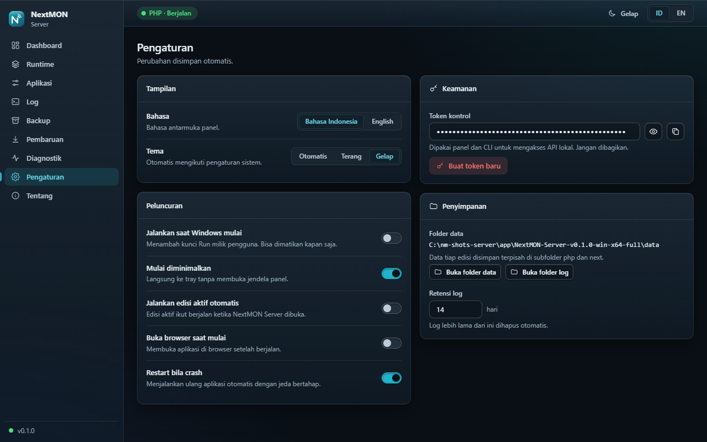<br><sub>Pengaturan: bahasa, tema, peluncuran, token</sub></td></tr>
<tr><td align="center">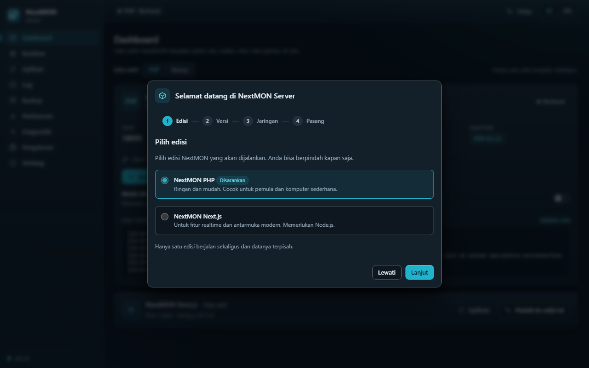<br><sub>Wizard pertama kali dipakai</sub></td><td align="center">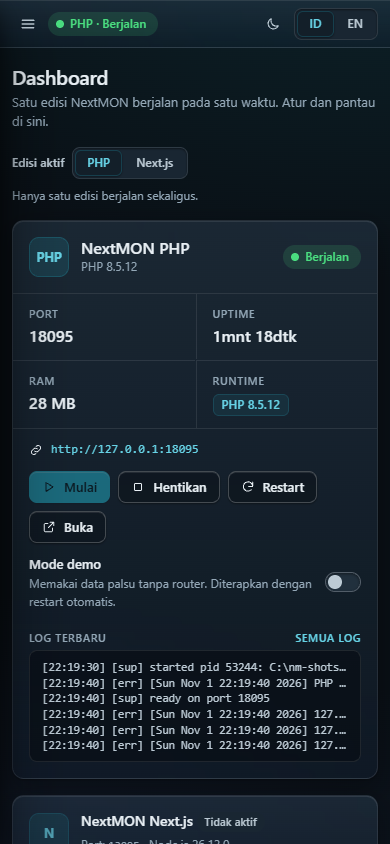<br><sub>Tampilan ponsel</sub></td></tr>
</table>

## Pakai (pengguna)

Unduh dari halaman [Releases](https://github.com/FirmanKurniawan/NextMon/releases) repo NextMON (paket rilis diterbitkan bersama aplikasinya):

| Paket | Isi |
|---|---|
| `NextMON-Server-vX.Y.Z-win-x64.zip` (lite) | exe + aplikasi PHP & Next.js. PHP/Node diunduh dari panel saat pertama dipakai |
| `NextMON-Server-vX.Y.Z-win-x64-full.zip` | lite + PHP dan Node.js LTS bawaan (bisa jalan tanpa internet) |
| `NextMON-vX.Y.Z-source.zip` | kode sumber |
| `SHA256SUMS.txt` | verifikasi: `certutil -hashfile <zip> SHA256` |

1. Ekstrak zip ke folder mana saja (hindari `Program Files` bila tidak ingin masalah izin tulis).
2. Klik dua kali `NextMON Server.exe`. Wizard pertama membantu memilih edisi dan port.
3. Pilih edisi (PHP / Next.js), tekan **Mulai**, lalu **Buka** untuk membuka aplikasinya.

Kebutuhan: Windows 10/11 64-bit. PHP kadang butuh *Microsoft Visual C++ Redistributable*; halaman **Diagnostik** mendeteksinya dan memberi tautan. Bila WebView2 tidak ada, panel dibuka di browser bawaan.

### Struktur folder (portabel)
```
NextMON Server.exe        peluncur (tray + panel + CLI)
config.json               pengaturan (dibuat saat pertama jalan)
app/php/  app/next/       kode aplikasi (diganti saat update aplikasi)
runtimes/php/<versi>/     banyak versi berdampingan
runtimes/node/<versi>/
data/php  data/next       data pengguna (tidak ditimpa saat update)
logs/  backups/
ui/  docs/
```
Tidak menulis ke registry kecuali opsi *Jalankan saat Windows start* (kunci Run milik pengguna, bisa dimatikan).

### CLI
```
nextmon-server start [php|next]     jalankan (ganti edisi bila disebut)
nextmon-server stop | restart | status | quit
nextmon-server edition [php|next]   lihat/ganti edisi aktif
nextmon-server php  list|available|install <v>|use <v>|upgrade
nextmon-server node list|available|install <v|lts|latest>|use <v>|upgrade
nextmon-server backup create|list|restore <nama>
nextmon-server update check|apply
nextmon-server doctor | open | autostart on|off | version
```
Tambahkan `--json` untuk keluaran mesin. `status` keluar dengan kode 0 bila berjalan, 3 bila tidak.

### Port
Panel/API kontrol: **47878** (bila terpakai atau diblok Windows, server memilih port bebas dan menyimpannya di `config.json`). Aplikasi PHP: 8080, Next.js: 3000 (bisa diubah di halaman **Aplikasi**). Mengaktifkan akses LAN (`bind 0.0.0.0`) menampilkan peringatan; atur firewall sendiri.

## Pengembangan

Struktur Cargo workspace:

| Bagian | Isi |
|---|---|
| `crates/runtimes` (`nm_runtimes`) | manajer runtime PHP/Node: daftar online (cache 6 jam, aman offline), unduh dengan progres + verifikasi sha256, ekstrak anti zip-slip, `php.ini` otomatis, health-check |
| `crates/server` (`nextmon-server`) | supervisor proses, API kontrol HTTP, tray, jendela panel (wry/WebView2), CLI, backup, update, diagnostik |
| `ui/` | panel kontrol (HTML/CSS/JS murni, tanpa CDN), ditanam ke exe saat build; lihat [ui/README.md](ui/README.md) |
| `tools/mock-server.mjs` | server tiruan Node untuk mengembangkan UI tanpa Rust |
| `scripts/package.ps1` | membuat zip rilis (lite, full, source) + `SHA256SUMS.txt` |
| `docs/SERVER-SPEC.md` | kontrak: config, API kontrol, perilaku server |

```powershell
# butuh Rust (MSVC toolchain)
cargo build --release -p nextmon-server
cargo test  -p nextmon-server

# UI tanpa Rust
node tools/mock-server.mjs            # http://127.0.0.1:8791 (--fresh = keadaan awal, --no-inject = uji dialog token)

# paket rilis (build ke C:\nm-stage agar tidak memenuhi drive proyek)
powershell -File scripts\package.ps1 -Version 0.1.0
```
Exe butuh folder `app/php` (dan `app/next`) di sampingnya; `package.ps1` menyalinnya dari repo [NextMON](https://github.com/FirmanKurniawan/NextMon). Untuk menjalankan dari `dist-dev/` salin sendiri `nextmon-php` ke `app/php`.

## Yang sudah teruji
- `cargo test -p nextmon-server`: unit/API dan tes supervisor (backoff restart, port sibuk, pembersihan proses yatim, zip-slip, update swap + rollback, aturan Host/Origin/token).
- Dijalankan sungguhan di Windows 11: start/stop/restart PHP, pindah edisi ke Next.js dengan Node bawaan, panel di WebView2, backup/restore, restart otomatis setelah proses dimatikan paksa, proses anak ikut mati bila peluncur dimatikan paksa, instance kedua menampilkan panel yang sudah ada.
- Panel: semua halaman diuji terhadap server tiruan (gelap/terang, id/en, 360 px) dan pemeriksaan aksesibilitas axe.

## Belum / batasan
- Berhenti (stop) memakai terminasi paksa; PHP/Node tidak punya jalur berhenti halus di sini.
- Peluncur tidak memperbarui dirinya sendiri; pembaruan aplikasi hanya mengganti `app/`, `ui/`, `docs/`. Alur unduh dari GitHub Releases baru diuji lewat unit test, belum dengan rilis nyata.
- Pasang runtime dari internet lewat panel belum diuji end-to-end pada semua versi (paket *full* membawa runtime yang sudah terverifikasi).
- Ikon tray tidak menghasilkan error, tetapi tampilannya belum diperiksa secara visual.
- Hanya Windows x64.

## Lisensi
MIT. Proyek independen; tidak berafiliasi dengan Mikhmon/Laksa19 maupun MikroTik.
